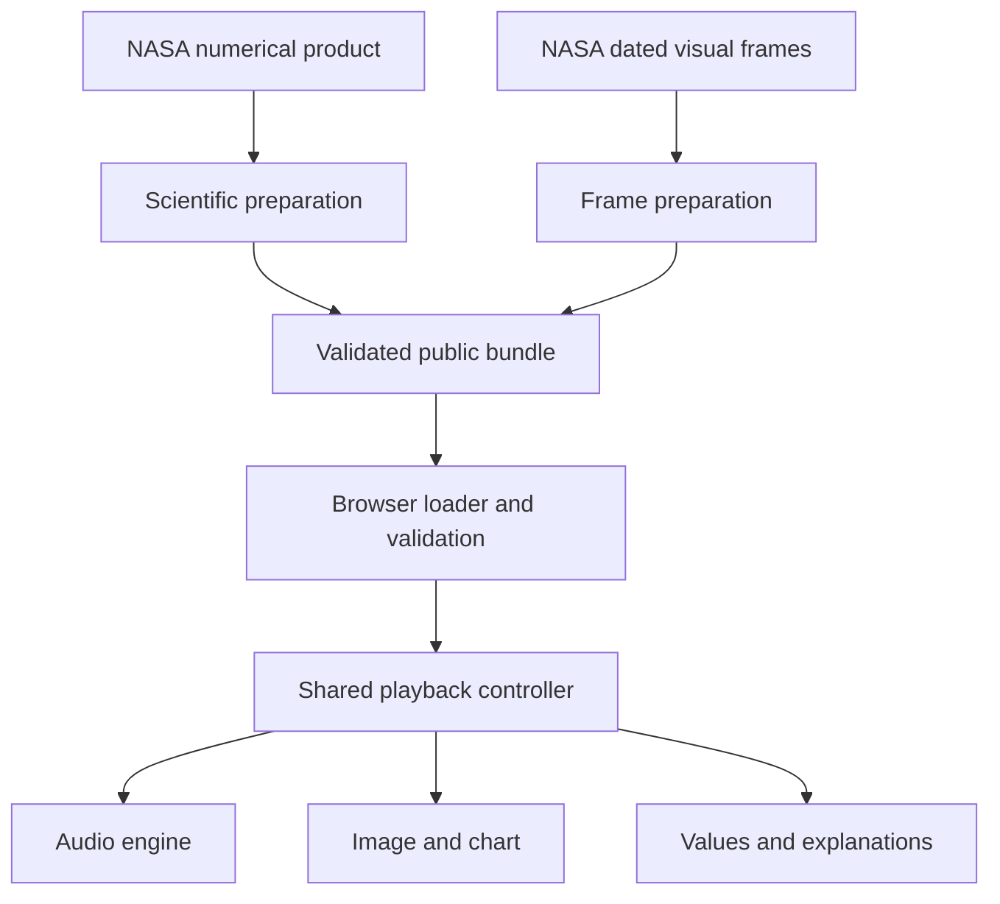
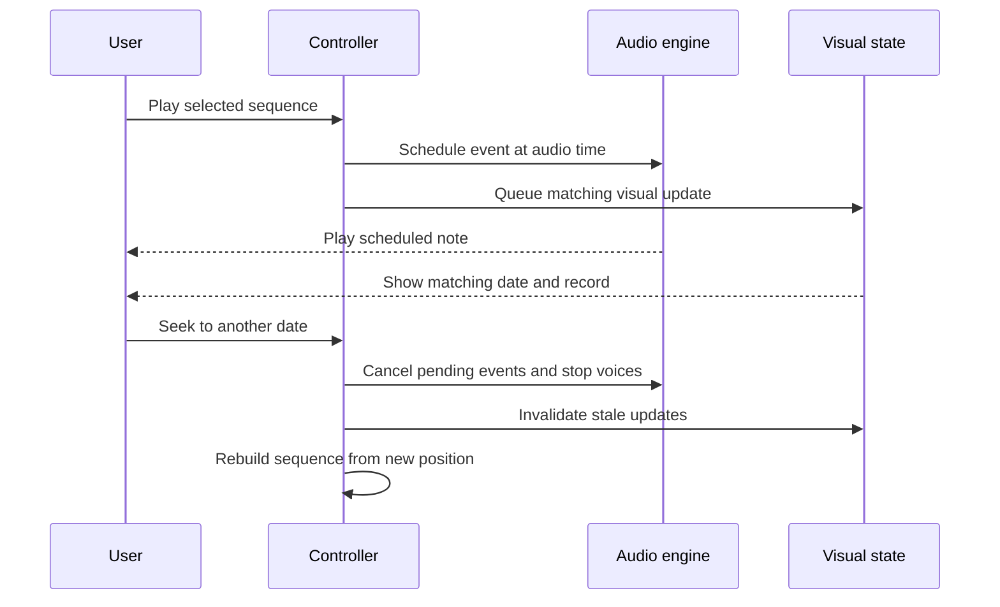

# EarthScore — Platform architecture and implementation workflow

Prepared: 1 November 2026. Filename retained as requested: `Architechture.md`.

**Document status:** proposed implementation architecture. No platform, scientific bundle, benchmark, or user study is delivered by this document. Read [CLAUDE.md](./CLAUDE.md) for the stack, directory layout, and developer responsibilities. The existing overview remains in [Earth_Information_Jukebox_Complete_Guide.md](https://chatgpt.com/library?file_id=libfile_2cf277a422c08191ad92c1befd789297&account_id=personal).

## Contents

1. [System boundary](#1-system-boundary)
2. [Architecture](#2-architecture)
3. [Scientific data pipeline](#3-scientific-data-pipeline)
4. [Data contracts](#4-data-contracts)
5. [Sonification](#5-sonification)
6. [Visualization](#6-visualization)
7. [Playback and synchronization](#7-playback-and-synchronization)
8. [Interface and accessibility](#8-interface-and-accessibility)
9. [Failure handling](#9-failure-handling)
10. [Build order](#10-build-order)
11. [Validation and deployment](#11-validation-and-deployment)
12. [Limitations and future extensions](#12-limitations-and-future-extensions)
13. [References](#13-references)

## 1. System boundary

The initial platform displays a NASA Earth visualization, plays sound derived from matched sea-surface-temperature measurements, and explains the relationship. A user selects a region and observation date, plays a sequence, or compares two regions.

Initial scope: one variable, approximately 30 matched daily observations, and three predefined regions. Exact dates and boundaries must be selected after inspecting available data. These are engineering choices, not official challenge requirements.

The full official challenge statement still needs a final compliance review. Earlier retrieval established the summary concerning EIC visuals and dynamic sonification, but did not verify all detailed requirements. This design is not a substitute for those rules.

### Essential distinctions

| Term | Meaning here |
|---|---|
| Observation time | Time/date represented by a scientific record |
| Playback time | Seconds spent listening to that record |
| Real-time sound generation | Sound calculated during interaction |
| Live data | Newly arriving measurements; not required by this proposed architecture |
| Sonification | A declared transformation from measurements into sound |
| Natural sound recording | An acoustic recording; this project does not produce one |

Thirty daily observations can be played in seconds. Playback speed does not change the original dates or measurements.

## 2. Architecture

### 2.1 Data preparation and browser execution



Preparation may require NASA authentication. Browser execution reads only public, prepared assets and generates sound locally. The static host serves files; it does not calculate scientific results on each click.

### 2.2 A concrete example

Suppose a selected record contains an illustrative regional mean of 16.5 °C. The controller selects that record, the viewer displays its matched image and region footprint, the chart highlights that date, the audio mapping returns 440 Hz under the proposed settings, and the explanation panel shows the same temperature and mapping. Changing the region selects a different record and repeats this process.

The controlling principle is **one observation identity, multiple representations**.

## 3. Scientific data pipeline

### 3.1 Sources

| Source | Use |
|---|---|
| [NASA SVS SST visualization 5101](https://svs.gsfc.nasa.gov/5101/) | Dated imagery and its source documentation |
| [MUR-JPL-L4-GLOB-v4.1](https://podaac.jpl.nasa.gov/dataset/MUR-JPL-L4-GLOB-v4.1) | Numerical temperature, coordinates, time, masks, analysis-error information |
| [EIC daily visualization collection](https://svs.gsfc.nasa.gov/gallery/daily-visualizations/) | Context for the selected visual asset |

MUR is a gridded Level-4 analysis. Do not describe every pixel as an independent direct satellite measurement. Read variable metadata and mask definitions from the actual files/product documentation.

### 3.2 Acquisition — `download.py`

1. Read selected date range and geographic boundaries from configuration.
2. Authenticate in the preparation environment using the supported Earthdata workflow.
3. Discover available granules and choose a consistent product version.
4. Retrieve the required data, using available subsetting when suitable.
5. Record granule identifiers and source URLs; retain raw inputs outside Git.

Avoid downloading a long, full-resolution global archive for a small regional prototype. A development machine needs only the chosen period and areas.

### 3.3 Processing — `preprocess.py`

1. Open files with metadata-aware decoding.
2. Verify units, coordinate conventions, timestamps, and fill values.
3. Normalize longitude conventions consistently before regional selection.
4. Apply documented valid-ocean and finite-value checks.
5. Convert temperature once: `temperatureC = temperatureK - 273.15`.
6. Calculate the area-weighted mean for each fixed region and date.
7. Calculate valid-area coverage and apply a documented minimum-coverage rule.
8. Preserve missing observations as `null` with a reason.

The coverage threshold is a project parameter requiring justification. Do not invent a NASA-recommended threshold.

For valid cell temperature $T_i$, cell area $A_i$, and inclusion flag $m_i$:

$$
\bar T = \frac{\sum_i A_i m_i T_i}{\sum_i A_i m_i}.
$$

Use cell areas derived from bounds when available. For a regular latitude/longitude grid, cosine-latitude weighting is an approximation; document it if used. Handle partial boundary cells consistently. Coverage is valid included ocean area divided by the target ocean area for the region, using a documented ocean-domain definition; it is not simply the percentage of non-null array elements.

If the denominator is zero, return missing data. Do not replace missing cells with zero, average land temperatures into ocean values, or silently interpolate a gap.

### 3.4 Frame preparation — `prepare_frames.py`

- Associate each frame with its documented observation date.
- Record projection, geographic extent, padding/cropping, and source URL.
- Resize images for browser use without changing their geographic alignment.
- Check near-real-time versus revised numerical products; disclose any unresolved mismatch.
- Keep filenames descriptive, but use metadata identifiers rather than filename sorting as the join key.

### 3.5 Export and validation

`export_bundle.py` writes a versioned JSON bundle and asset paths. `validate.py` checks sorted unique timestamps, valid region references, finite numbers or explicit nulls, coverage bounds, and frame correspondence. Record processing configuration and a bundle checksum. Validation failures stop publication of that bundle.

## 4. Data contracts

Agree on these contracts before teammates implement separate modules. These are illustrative TypeScript schemas, not already-generated application code.

```ts
type Region = {
  id: string;
  name: string;
  bounds: { west: number; east: number; south: number; north: number };
  crossesAntimeridian: boolean;
};

type Observation = {
  regionId: string;
  frameId: string;
  timestamp: string;            // ISO timestamp with timezone
  temperatureC: number | null;
  validCoverage: number;        // 0 to 1
  qualityStatus: "valid" | "missing" | "insufficient-coverage";
};

type Frame = {
  id: string;
  timestamp: string;
  assetPath: string;
  sourceUrl: string;
};

type MappingConfig = {
  id: string;
  minTemperatureC: number;
  maxTemperatureC: number;
  minFrequencyHz: number;
  octaves: number;
};
```

The manifest additionally includes schema version, bundle version, product version, units, aggregation method, preparation timestamp, source references, frame projection/extent, coverage rule, and mapping configuration. Preserve native timestamps and document any date-only matching rule explicitly.

Reject duplicate `(regionId, timestamp)` keys. Every observation must reference a known region and a date-compatible frame. Reject non-finite JSON values, unknown schema versions, and invalid mapping bounds. Use a versioned asset directory or consistent manifest-controlled paths so cached files from different bundles cannot mix.

### Derived display record

`selectors.ts` produces one read-only object containing the selected observation, region, frame, mapped frequency, and clipping flag. All display components consume this object. The audio engine receives its corresponding scheduled event rather than re-fetching data.

## 5. Sonification

### 5.1 What is mapped

| Data or control | Audio behaviour |
|---|---|
| Temperature | Pitch, through a fixed monotonic mapping |
| Observation sequence | Ordered notes in playback time |
| Playback speed | Time between observations |
| User volume | Output gain, independent of temperature |
| Missing measurement | No temperature note; explicit missing-data status |

Begin with the same simple timbre for both comparison regions. Avoid encoding multiple variables in pitch, loudness, and rhythm before users can understand a single mapping.

### 5.2 Mapping equations

For temperature $T$ and shared mapping bounds $T_{min}$ and $T_{max}$:

$$
u = \operatorname{clip}\left(\frac{T-T_{min}}{T_{max}-T_{min}},0,1\right),
\qquad f = f_{min}2^{Ou}.
$$

- $u$: dimensionless normalized value.
- $f$: oscillator frequency in hertz.
- $f_{min}$: lowest mapped frequency.
- $O$: mapped span in octaves.
- Clipping limits sound range; it must not alter the stored measurement.

Proposed initial settings: $T_{min}=-2$ °C, $T_{max}=35$ °C, $f_{min}=220$ Hz, $O=2$. Validate these with the chosen data and listeners. They are not published optimum settings.

Worked example: $T=16.5$ °C gives $u=18.5/37=0.5$, and $f=220\times2^1=440$ Hz. The endpoints map to 220 and 880 Hz.

Equal increments of temperature produce equal ratios of frequency, corresponding to equal musical pitch intervals. This is parameter mapping, not an acoustic model of ocean temperature.

### 5.3 Mapping function behaviour — `temperatureMapping.ts`

Input: temperature or null, and validated configuration. Output:

```ts
type MappedSound = {
  frequencyHz: number | null;
  clipped: boolean;
  originalTemperatureC: number | null;
};
```

Reject invalid configurations such as reversed bounds, non-finite numbers, or nonpositive frequency. Return no frequency for missing observations. Use the same configuration for every compared region and date. Never normalize each series independently.

### 5.4 Sound generation — `AudioEngine.ts`

1. Create the audio context/instrument only after an explicit Enable Sound action.
2. Reuse the instrument across notes.
3. Accept a frequency and an absolute audio-clock start time.
4. Apply short attack/release envelopes to avoid abrupt waveform discontinuities.
5. Keep gain comfortable and independent of measurement value.
6. Expose stop, volume, and disposal methods.

A proposed initial event spacing is 0.5 seconds, with a shorter note and a small gap. These are tuning parameters. At faster speeds, shorten notes so intended nonoverlapping playback remains nonoverlapping.

Changing frequency smoothly can improve comfort, but a glide between daily values is an audio transition—not an observed intermediate temperature. Keep that distinction clear in explanations.

### 5.5 A/B mode

For each date, schedule A then B, label the active region visibly, then advance the date. Both use identical mapping, timbre, duration, and gain. The chart can show both curves with labels and different line styles. Define speed as seconds per region event; a two-region date therefore takes two event intervals.

If A or B is missing, preserve the slot and show missing status rather than changing the ordering. Optionally introduce a distinct explained cue later; never reuse a temperature note as a missing-data cue.

### 5.6 Optional musical mode

Quantizing to scale notes can be added as a separate artistic mode. Label the loss of precision, keep analytical mode available, and store a separate mapping identifier. Musical pleasantness is not evidence of scientific accuracy or comprehension.

## 6. Visualization

### 6.1 Earth viewer — `EarthViewer.tsx`

Render the NASA frame with an SVG overlay sharing the exact image viewport. Overlay fixed region boundaries and highlight the selected region. Handle letterboxing and responsive resizing using the actual rendered image rectangle rather than the surrounding container.

For an uncropped, full-world equirectangular map:

$$
x=W\frac{\lambda+180}{360},\qquad y=H\frac{90-\phi}{180}.
$$

Here $\lambda$ is longitude, $\phi$ is latitude in degrees, and $W,H$ are rendered map dimensions. Longitude/latitude zero map to the centre. This transform is invalid for other projections or unaccounted padding. Split regions crossing the antimeridian instead of drawing a box across the entire map.

The first version allows only prepared region selections. An unrestricted map click must not display a regional mean as if it were a point measurement.

### 6.2 Time-series chart — `TemperatureChart.tsx`

- X-axis: actual observation time; y-axis: temperature in °C.
- Plot the same processed records used for audio.
- Preserve missing values as gaps rather than bridging them silently.
- Highlight the selected date and active comparison region.
- Allow chart selection to dispatch the same SEEK action as the date control.
- Provide a labelled table alternative and exact values.

For comparisons, use a common y-axis scale. Chart scaling and pitch scaling need not share numeric bounds, but both must be explicit; neither may independently distort the relative ordering between regions.

### 6.3 Explanation panel — `MeasurementPanel.tsx`

Show date, region and footprint, temperature, units, aggregation, coverage, frequency, mapping limits, and source. Include clipping or missing-data status. “Why this sound?” explains the transformation in plain language.

Do not call a regional mean the temperature of every location inside the highlighted region. Do not infer warming causes from a short time series.

## 7. Playback and synchronization

### 7.1 Single source of state

```ts
type PlaybackState = {
  status: "loading" | "ready" | "playing" | "paused" | "error";
  dateIndex: number;
  selectedRegionId: string;
  comparisonRegionId: string | null;
  activeSlot: "A" | "B";
  secondsPerEvent: number;
  soundEnabled: boolean;
  volume: number;
};
```

Keep mutable audio handles and scheduled-event IDs in the controller, not serialized React state. Compute temperatures from the dataset rather than duplicating them in state.

### 7.2 Shared event model

`createPlaybackEvents.ts` constructs events containing observation identity, date index, A/B slot, playback offset, and mapped audio parameters. Audio and visuals consume the same events.



### 7.3 Timing algorithm

1. Preload/validate the selected data and required visual frames before starting the small demo sequence.
2. Establish an audio-clock start time and schedule a short future window.
3. Pass each note's scheduled time into the audio engine; do not trigger it merely when a JavaScript timer wakes up.
4. Schedule visual updates for the corresponding presentation time using an audio-linked drawing mechanism, with browser rendering as close as possible to that time.
5. Refill the scheduling window while playing.
6. Use a generation token to invalidate stale callbacks after pause, seek, speed changes, or region changes.

Browser rendering and device output introduce latency. This approach aims for perceptual synchronization; it is not a guarantee of sample-accurate visible updates. Measure on the demonstration device.

### 7.4 Required transitions

| Action | Behaviour |
|---|---|
| Play | Start from selected date/slot; resume audio context if necessary |
| Pause | Cancel future events, stop current voice, retain selected observation |
| Resume | Replay selected observation from its start; this MVP does not resume within a note |
| Stop | Cancel everything and return to first date, slot A |
| Seek | Cancel old sequence, select date, restart at slot A if previously playing |
| Region/comparison change | Cancel, update selection, rebuild from current date |
| Speed change | Cancel future schedule and rebuild from the current observation |
| Disable sound | Silence/cancel voices; preserve shared visual playback |
| End of sequence | Stop voices and remain on final observation; no automatic loop |
| Hidden tab or suspended audio | Pause and retain position; require deliberate resume |

Do not use independent `setInterval` loops for image, chart, and sound. Visual-only playback still uses one controller/timeline; turning audio on rebuilds scheduling at the current observation rather than starting a second timeline.

## 8. Interface and accessibility

Recommended screen order: short introduction and Enable Sound; region/date controls; Earth viewer; playback controls; chart; comparison controls; measurement explanation and source table.

Provide semantic buttons and labelled controls, visible keyboard focus, sufficient contrast, non-colour distinctions, adjustable volume, and a data table. A map is an optional selection route; the region dropdown is equally capable.

The sound legend plays low/middle/high references with values and explains the mapping. Pause data playback while the legend plays so it cannot be mistaken for a measurement. Provide an explicit Read Current Value action. Avoid automatically announcing every rapidly changing value through a screen reader.

If narration is enabled, pause or duck the data sound deliberately and explain the behaviour. Accessibility claims must match actual evaluation: describe features as designed for access until they have been tested with intended users.

## 9. Failure handling

| Failure | Response |
|---|---|
| Invalid/mixed bundle | Stop loading and show an actionable error |
| Missing frame | Do not advance paired playback with an old image; pause and identify unavailable date |
| Missing scientific value | Preserve time position; show missing status and omit temperature note |
| Low coverage | Follow documented exclusion rule and display status |
| Audio blocked | Show Enable/Resume Sound and keep data inspection available |
| Out-of-range temperature | Preserve value, flag clipping, explain pitch ceiling/floor |
| Network interruption | Use already-loaded assets; report unavailable remaining assets |
| Component remount | Dispose old audio resources and listeners |

No successful-looking fallback may silently substitute unrelated measurements or images.

## 10. Build order

| Stage | Work | Acceptance gate |
|---|---|---|
| 1 | Agree on contracts and labelled fixture | Both teammates render/select the same example record |
| 2 | Retrieve and process one real region | Units, mask, mean, and provenance checked |
| 3 | Add one matching frame and numerical panel | Date and footprint agree |
| 4 | Implement one-note mapping and audio | Known input gives expected frequency; sound stops |
| 5 | Add chart and shared playback | Selected record agrees across all outputs |
| 6 | Extend dates and regions | Full bundle passes validation |
| 7 | Add A/B mode and cancellation | Seek, speed, and region changes leave no stale notes |
| 8 | Add legend, accessible navigation, explanations | New user can describe the mapping and inspect a value |
| 9 | Test production build and demo | Sources, limitations, controls, and assets work on target device |

Do not build all components in isolation before testing an end-to-end slice. The first integration should contain one real record, one frame, one note, and one explanation.

## 11. Validation and deployment

### Scientific checks

- Compare a small processed sample with source values.
- Check Kelvin conversion, mask decoding, longitude handling, and area weighting.
- Test an all-missing region and a partially covered region.
- Check date matching and known projection landmarks.
- Verify that changing the audio range does not modify stored measurements.

### Audio and state checks

- Same temperature/configuration produces the same frequency.
- Increasing in-range temperature increases frequency.
- Missing values do not become low-temperature notes.
- Clipped values retain an explicit flag.
- Pause/seek/change events cancel pending sound and stale visual updates.
- A/B values use one mapping and the documented order.

### User checks

Ask participants to identify a warmer region, recognize increasing/decreasing values, and inspect an exact measurement. Record task accuracy, completion time, confusing controls, and enjoyment separately. If comparing modes, use equivalent tasks and balanced presentation order where feasible. A small formative pilot identifies usability problems; it does not prove general learning improvement.

### Deployment

Build the static frontend and deploy its generated assets over HTTPS. Configure asset paths for the chosen base URL and serve correct file types. Keep the manifest and associated data/images from the same bundle version. Do not assume offline capability merely because files are cached; either implement it explicitly later or retain a locally runnable demo copy.

Test the actual laptop, browser, headphones/speakers, and network. Check manual audio start, rapid seeking, background/resume behaviour, keyboard navigation, and asset loading. Save a short backup recording without presenting it as the live interactive prototype.

## 12. Limitations and future extensions

| Limitation | Consequence | Possible extension |
|---|---|---|
| One variable and fixed regions | Limited exploration | Add validated gridded browsing after data-volume planning |
| Regional means | Local structures may disappear | Point inspection and distribution summaries |
| Shared wide pitch range | Small changes may be hard to hear | Explicit user-selectable sensitivity mode with disclosed bounds |
| Short time span | No defensible long-term climate claim | Add a suitable long-term baseline and analysis |
| Musical quantization | Loss of precision | Separate artistic mode and preserve analytical mode |
| Per-cell error estimates | Not automatically regional confidence intervals | Investigate spatial covariance before aggregation |
| Untested access needs | Accessibility effectiveness uncertain | Co-design and evaluate with intended users |

Do not add anomaly detection, neural music generation, marine-heatwave claims, or a second Earth variable simply to increase the feature count. Each extension needs a scientific definition, suitable data, an interpretable mapping, and a validation plan.

## 13. References

These links support the selected data and implementation concepts. The architecture and settings in this document are project proposals, not measured results from these sources.

- [NASA SST visualization](https://svs.gsfc.nasa.gov/5101/)
- [MUR numerical product](https://podaac.jpl.nasa.gov/dataset/MUR-JPL-L4-GLOB-v4.1)
- [Earthaccess documentation](https://earthaccess.readthedocs.io/en/latest/)
- [Tone.js documentation](https://tonejs.github.io/)
- [Web Audio API documentation](https://developer.mozilla.org/en-US/docs/Web/API/Web_Audio_API)
- [Accessible Oceans: inclusive ocean sonification design](https://tos.org/oceanography/article/expanding-access-to-ocean-science-through-inclusively-designed-data-sonifications)
- [Infosonics](https://doi.org/10.1145/3491102.3517465)
- [Mapping strategies review](https://doi.org/10.1371/journal.pone.0082491)
- [Earth system music](https://doi.org/10.5194/gc-3-263-2020)
- [Official challenge](https://www.spaceappschallenge.org/2026/challenges/the-earth-information-jukebox/)
